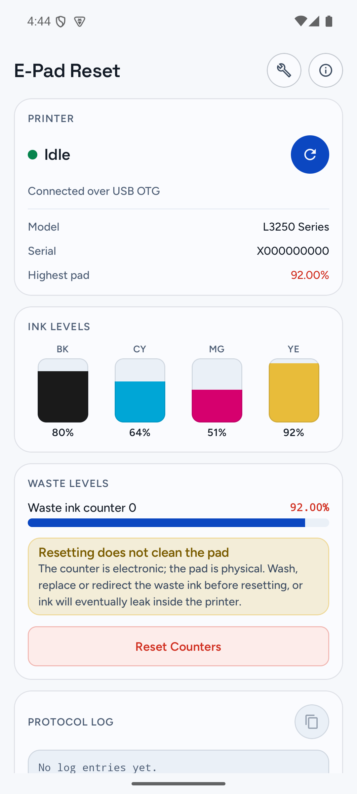
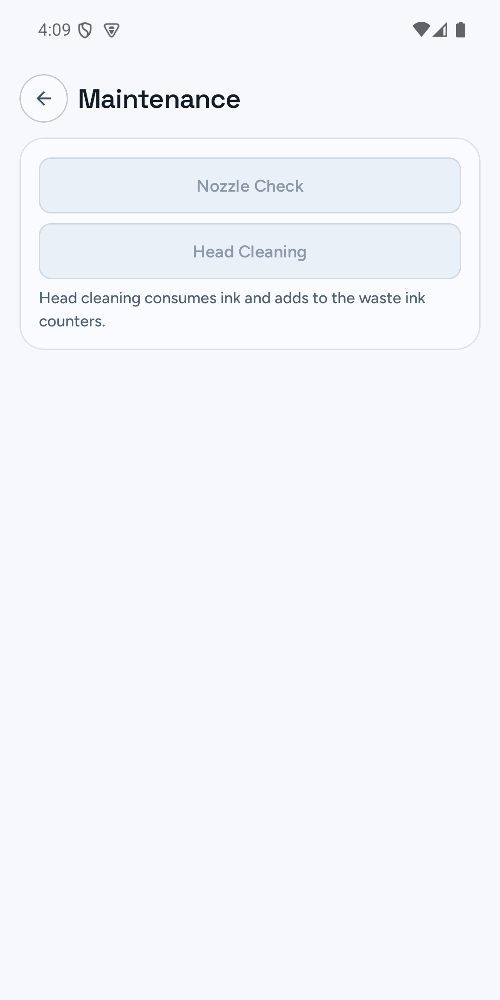
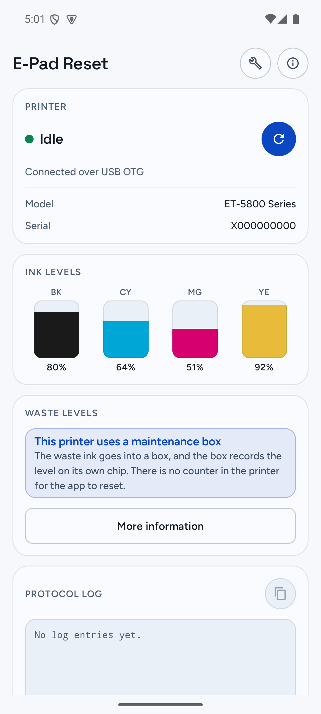

# E-Pad Reset

<p align="center">
  <a href="https://github.com/padreset/e-padreset/releases">
    
  </a>
</p>

<p align="center">
  
  
  
</p>

Android port of [`ez-reset`](https://github.com/CiRIP/ez-reset) for Epson printer maintenance over USB OTG.

This app is aimed at Epson inkjet printers that expose the same service protocol used by `ez-reset`. It can detect supported Epson USB devices, open the control channel, read printer status, inspect waste ink counters, issue waste counter write/reset commands, and send maintenance jobs such as nozzle check and head cleaning directly from an Android device.

## What It Does

- Detects Epson USB printers via Android USB Host API
- Reads IEEE 1284 device ID and resolves printer model data from the bundled Epson database
- Enters Epson IEEE 1284.4 / D4 mode and opens the `EPSON-CTRL` channel
- Reads printer status, including ink levels when exposed by the printer
- Reads waste ink counters from EEPROM
- Writes or resets waste ink counters using model-specific reset values
- Reads and keeps the bytes it is about to overwrite before any write, and stops at the first write the printer refuses
- Saves those bytes to private preferences before every write, and writes them back on request, so a reset can be undone after the app has been closed
- Runs model-dependent head cleaning commands over Epson service protocol where supported
- Falls back to USB ESC/P2 maintenance jobs for head cleaning on models that reject service cleaning
- Prints nozzle check patterns over USB
- Connects to models that have no resettable counter — maintenance-box printers — so head cleaning and the nozzle check still work, and explains why there is nothing to reset
- Names connection failures and offers a local, editable model-support report with copying, Discord, GitHub and Android sharing; no diagnostic data in browser URLs and no in-app networking
- Distinguishes "no Epson printer attached" from "a printer is attached, but it is not an Epson"
- Scans for a printer on launch instead of waiting for the refresh button, and drops the connection when it is unplugged
- Shows its own version in About, and can open a releases page once the fork publishes one — the app holds no network permission and never checks by itself
- Shows a compact status monitor UI inspired by `ez-reset`
- Includes an in-app protocol log for debugging USB / D4 traffic

## Current UI

Two pages, reached from the header.

**Status** — the printer's condition:

- `Ink Levels` panel with adaptive single-row gauges for 4 to 8 inks
- `Waste Levels` panel with dynamic counter rows, or an explanation when the model has no counter to reset
- `Restore a backup` panel listing the saved backups, newest first, each saying which write found it and what its counters read, with a box for pasting one that was copied out earlier
- Protocol log with a copy action, read top to bottom: first event at the top, latest at the bottom, anchored on the latest

The log scrolls inside a page that also scrolls, which is two scrollables in one
gesture. By default Compose hands the scroll the log did not use up to the page,
so reaching either end of the log started moving the page instead of stopping.
The log now claims that leftover while it has lines out of view, so its ends hold
still. It claims nothing when the log fits entirely: swallowing the gesture there
would block the page behind a panel that has nowhere to scroll.

**Maintenance** — acting on the printer:

- `Nozzle Check`, then `Head Cleaning` (check before you clean: the diagnostic costs almost no ink)

The header carries circular icon buttons for maintenance and about, and a refresh button on the status card. Android back returns from Maintenance to Status, and asks for confirmation before exiting.

## Technical Notes

- Platform: Android 7.0+ (`minSdk 24`)
- Language: Kotlin
- UI: Jetpack Compose
- USB stack: `UsbManager`, `UsbDeviceConnection`, bulk endpoints, printer-class control requests
- Protocol: Epson `st` / `||` commands over D4 / IEEE 1284.4, plus USB ESC/P2 maintenance print jobs where needed
- Model database: bundled `devices.xml` from the upstream `ez-reset` project, extended by `reinkpy_models.xml`
- Permissions: the source manifest declares no `uses-permission` (no `INTERNET`, offline by design). The merged
  manifest additionally declares `com.padreset.epadreset.DYNAMIC_RECEIVER_NOT_EXPORTED_PERMISSION`, injected by
  AndroidX Core so the USB-detach receiver can be registered as not-exported — signature-level, own package,
  never user-facing.

### Which USB interface to use

A printer exposes more than one interface with bulk endpoints, and which one
carries D4 differs by model. An L365 answers on its printer-class interface and
ignores the vendor-specific one, which is the order the app would otherwise try
first.

Getting it wrong is not fatal, because the remaining candidates are tried, but
the failed attempt has to run out its IEEE 1284.4 reply window (two seconds)
before the fallback. That is the wait the user sees on a first launch.

So the interface that worked is written to `SharedPreferences` and tried first
next time. It is keyed on vendor and product id, not on the device path, which
changes on every replug and would make the preference unreachable.

The first connect to a printer is still slow, because there is nothing to
remember yet. Every one after it is not.

While that happens the status card says so instead of leaving the wait
unexplained. The note is raised at the one point where the wait is knowable
before it happens: the printer did not answer the IEEE 1284.4 handshake on the
interface being tried. That is what a wrong interface looks like, and the
attempt moves straight on to the next candidate instead of paying the eight
second D4 read, so saying so at that moment is
the difference between an explained wait and a spinner with no reason given.

It cannot be raised any earlier. Before the handshake there is no evidence
either way, and guessing would put the note up on connections that turn out to
be fast.

The floating pill changes too, from "Working…" to "Trying another route…". The
pill is what the eye lands on first, so it carries the headline and the card
carries the explanation. It stays to a few words because the pill is only as
wide as its text, and a longer sentence there would cover the panels behind it.

### The nozzle check is three commands, not a choice of two

The maintenance page used to offer a "standard" and an "alternative" nozzle test.
They were `NC 00 00` and `NC 00 10` — the same command with one argument byte
changed — and the second one did nothing on an L365: the panel lit up, waited, and
gave up without a word.

The reference implementation, `escputil` from GIMP-Print, sends **three** commands
in one session: `VI 00 00`, then `NC 00 10`, then `NC 00 00`. Capturing its bytes
is a matter of pointing it at a file rather than a printer:

```bash
touch /tmp/nc.bin && escputil --nozzle-check --raw-device /tmp/nc.bin -m escp2-et2750
```

The `0x10` form is the *first* step of that sequence, not a variant of it. Sent
alone it leaves the printer mid-sequence, which is exactly the "starts and gives
up" that was reported. yusnel-rojas sends the same three commands byte for byte,
and has it proven end to end on an ET-2820; the sequence here is now that one, and
`Escp2MaintenanceProtocolTest` pins the order.

Where the split came from: Ircama's `epson_escp2` exposes the two `NC` commands as
`check_nozzles(type=0)` and `check_nozzles(type=1)`, and this app inherited that
pairing — including its labels. It is the odd one out among the tools that
implement this.

## Fonts

The UI uses two typefaces from the [Google Fonts](https://github.com/google/fonts) repository, both
under the SIL Open Font License:

- **Space Grotesk** — display text (headings, the printer state)
- **Figtree** — body text
- **Monospace** — protocol log and technical values

They are bundled as **static instances, one file per weight**, generated from the upstream variable
fonts with [`fonttools`](https://github.com/fonttools/fonttools):

```sh
fonttools varLib.instancer "Figtree[wght].ttf"       wght=400 -o figtree_regular.ttf
fonttools varLib.instancer "Figtree[wght].ttf"       wght=500 -o figtree_medium.ttf
fonttools varLib.instancer "Figtree[wght].ttf"       wght=600 -o figtree_semibold.ttf
fonttools varLib.instancer "SpaceGrotesk[wght].ttf"  wght=500 -o space_grotesk_medium.ttf
fonttools varLib.instancer "SpaceGrotesk[wght].ttf"  wght=600 -o space_grotesk_semibold.ttf
```

The generated files were then verified to have the `fvar` table removed and `OS/2.usWeightClass` set
to the matching value, and their `name` table rewritten so each file reports its real weight instead
of inheriting the upstream family name.

### Do not swap these for the variable fonts

The upstream variable files default to `wght=300` and identify themselves as `"Figtree Light"` and
`"Space Grotesk Light"` with `OS/2.usWeightClass = 300`. Dropping them into `res/font/` as a
replacement means **every declared weight resolves to Light 300**: headings declared as SemiBold
render thin, and the whole scale loses its hierarchy.

This is a silent regression. It compiles, it runs, and there is no error to search for — the only
symptom is text that looks wrong, which is easy to dismiss as a matter of taste.

If you need a weight that is not bundled, generate another static instance with the command above
rather than substituting the variable file.

The license texts are kept alongside the rest of the project's notices in
`app/src/main/res/raw/ofl_figtree.txt` and `ofl_space_grotesk.txt`.

## Printer Data

`assets/devices.xml` is the model database. It has two parts: a `<records>`
section mapping model names to spec names, and a `<devices>` section holding the
specs themselves. `EpsonPrinterCatalog` joins the two by the `specs` attribute.

A model is kept in the catalog when the app can open a session with it and then
do something useful: it needs a control model, a keyword, and either waste
counters or cleaning jobs. Waste counters are **not** required. Models that
collect waste ink in a maintenance box carry no counter but do carry their
cleaning jobs, and head cleaning and the nozzle check still work on them.
Requiring counters is what once made those models answer "Unsupported Epson
model" instead of connecting.

### Models with a maintenance box

`assets/maintenance_boxes.xml` lists the models that use a maintenance box
rather than an internal pad. On those, the fill level lives on the box's own
chip, so the printer holds no counter for this app to reset.

This cannot be derived from `devices.xml`. Three candidate signals were measured
against a known classification and all three failed:

| Signal | Result |
|---|---|
| `class` attribute | identical (`epson.printer.dd4.standard`) across both groups |
| `EPxx` spec | mixed — EP10 is 56 without a box and 112 with one |
| a `<waste>` node | absent in 275 of the 276 affected models, splitting 159 / 116 |

So the distinction is carried as data, and the source is the
[reinkpy](https://codeberg.org/atufi/reinkpy) project (AGPL-3.0). reinkpy's
database records, per model, whether the counter lives in the printer
("Waste counter") or on the box's chip ("Platen pad counters"); the file holds
its complete platen-only classification, 313 models. Only models also present
in `devices.xml` will ever match a connected printer — the rest are kept so the
file stays a faithful, regenerable copy of the source rather than a one-off
intersection.

A connected model with no counter that is **not** on the list is not
mislabelled either: it falls back to the neutral wording that names both
possible causes. The list only ever makes the message more specific.

The list also answers one question the catalog otherwise cannot. When a
connected printer is **not** in `devices.xml`, resolution fails and the app used
to say only that the model was missing. It now asks the list first: if the model
is on it, the model request is scoped to investigating cleaning/nozzle support,
not a counter reset, and the callout avoids promising an outcome the hardware cannot
deliver. Those models can now request investigation of cleaning/nozzle support,
but the report explicitly rules out resetting the maintenance-box chip.

### The models reinkpy has and `devices.xml` does not

`assets/reinkpy_models.xml` is the other half. `devices.xml` comes from ez-reset
and covers 1080 printers; reinkpy covers 1588. They overlap on 1021, so neither
is a superset and dropping either one loses printers. The extension holds the 554
models only reinkpy has, kept in its own file so `devices.xml` stays a byte for
byte copy of its upstream and can still be diffed against it. A model that
`devices.xml` already knows keeps its entry, because that one also carries the
counter ceiling and the cleaning jobs.

These models can read and they can reset: reinkpy publishes the read key, the
write key, the pad addresses and the reset values. What they cannot do is show a
percentage, because reinkpy does not publish the counter ceiling — the app shows
the raw reading instead and says why, rather than printing 0% for a pad that may
well be full. They also carry no cleaning payloads, so the maintenance page falls
back to the generic ESC/P2 job it already uses for the models that lack one.

### Regenerating both files

```sh
node scripts/sync-model-data.mjs           # verify, then regenerate
node scripts/sync-model-data.mjs --check   # exit 1 if either is stale, for CI
```

The script reads the parsed mirror of reinkpy published by
[`yusnel-rojas/epson-reset`](https://github.com/yusnel-rojas/epson-reset)
(`data/reinkpy/database.json`) rather than parsing reinkpy's `epson.toml`
itself: parsing the TOML is upstream's job and it already does it. It rewrites a
file only when its list actually changes, so the prose above survives a run that
finds nothing new, and it keeps the committed assets when the upstream is
unreachable instead of failing the build on a network blip.

### The cross-check runs before anything is written

`devices.xml` and reinkpy are independent extractions of the same printers, and
where they overlap they agree **exactly**. That agreement is the only evidence
behind the reinkpy-only models, because for those there is nothing to compare
against — so the script re-runs the comparison first and refuses to write if the
two ever diverge. Writing first and warning after would ship a catalog built on
data that no longer matches the one source it can be checked against.

| `devices.xml` | reinkpy | agreement |
|---|---|---|
| `<factory>`, two little-endian bytes | `rkey`, a 16-bit integer | 100% |
| `<keyword>`, eight bytes | `wkey`, an eight-character string | 100% |
| `<reset>` addresses | `pad_groups[].addresses` | 100% |
| `<reset>` values | `pad_groups[].reset` | 100% |

### Two guards, from two failures

**XML comments may not contain a double hyphen** — a dash underline in a header
broke the parse once — so the script refuses to write a comment containing one.
And a literal NUL is not a legal XML character: one write key is `"ASAP\0\0\0\0"`,
which renders as trailing spaces in a terminal, and the first version of the
extension was written with those NULs in it. Keywords are therefore stored as
explicit bytes, and the script rejects any control character in its output.

Both files load through `runCatching`, so a file that does not parse comes back
as an empty list with nothing the user can see. The Gradle task
`verifyPrinterData` parses all three assets on every build, fails when a list is
empty or truncated, and checks that every extension model carries a readable
`rkey` and `keyword` — a model without them would resolve, open no session, and
report the printer as unsupported, which is the exact failure the file exists to
fix.

## Community model requests

When a connected Epson model is missing, **Help add this model** opens a local
editable draft before any external action. The report uses an explicit allowlist
of IEEE1284 fields (`MFG`, `MDL`, `CMD`, `CLS`), numeric USB VID/PID, app/Android
versions and a catalog-failure summary. It does **not** attach arbitrary protocol
logs, serial-number fields or EEPROM backups: redacting a serial in the header
alone cannot remove the same data from hex packets or old log sessions. Users
must review anything they add themselves. Missing model names remain reportable.

After review the user can copy, open the existing Discord community, open the
GitHub model-request template or use Android's Sharesheet. Discord/GitHub require
accounts; sharing can use another app with someone willing to relay the request.
There is no dedicated email/form inbox configured and no guaranteed delivery
from choosing a share target. The GitHub URL includes only the static template
name, not the model or report, and opening a channel never pastes or publishes
anything automatically. The Android app keeps no `INTERNET` permission.

GitHub is the canonical technical tracker, with one issue per model. Discord is
an entry point and a place to help volunteers; maintainers can relay reviewed
technical data without making the user register for GitHub too. The issue form
lives in `.github/ISSUE_TEMPLATE/01-model-support.yml`. The bilingual setup,
copyable Discord template and triage guide are in [docs/model-support.md](docs/model-support.md).
Creating a forum on the server is a separate administrator action; this checkout
does not configure Discord or publish the templates. No email address or bot is
invented. Missing maintenance-box models may request maintenance support, never
a chip reset. Reports request investigation, not a guarantee or release date.

## Project Structure

- `app/src/main/java/com/padreset/epadreset/ui`
  UI, dialogs, status monitor, log panel
- `app/src/main/java/com/padreset/epadreset/service`
  Printer orchestration and command flow
- `app/src/main/java/com/padreset/epadreset/usb`
  Android USB Host transport
- `app/src/main/java/com/padreset/epadreset/protocol`
  Epson packet and D4 framing logic
- `app/src/main/java/com/padreset/epadreset/data`
  Printer model and status data structures
- `app/src/main/assets/devices.xml`
  Bundled Epson model database, from ez-reset
- `app/src/main/assets/maintenance_boxes.xml`
  Generated list of models that use a maintenance box, with provenance
- `app/src/main/assets/reinkpy_models.xml`
  Generated models that only reinkpy has
- `scripts/sync-model-data.mjs`
  Cross-checks the two sources, then regenerates both generated assets
- `play-store`
  What gets uploaded to the Play listing: the 512×512 icon, the 1024×500 feature
  graphic and the phone screenshots. The editable originals live in
  `play-store/source` rather than beside them, so the folder holds only files
  that are meant to be uploaded and there is nothing to guess at
- `docs`
  The GitHub Pages site, and the privacy policy URL the Play listing points at.
  Plain HTML with no build step, so what is committed is what is served

## Build

Open the project in Android Studio and build the `app` module.

The unit tests run on the JVM; the UI tests need a device or an emulator:

```sh
./gradlew :app:testDebugUnitTest           # parsers, protocol and write rules, no device
./gradlew :app:connectedDebugAndroidTest   # renders the screens, needs one
./gradlew :app:detekt                      # static analysis, no device and no Android SDK
```

The screen suite also runs on pull requests
(`.github/workflows/instrumented-tests.yml`), on an API 35 emulator. It does
not run on every push. It draws the UI. It does not exercise USB, OTG or
EEPROM; those still need a phone.

`detekt` also runs on every push and every pull request
(`.github/workflows/detekt.yml`), in under a minute and without the Android SDK,
because it parses Kotlin rather than compiling it. It is not a substitute for
`lintDebug`: lint reads resources, manifests and the merged permissions, and
detekt reads Kotlin.

What it is actually good for here is small, and worth stating plainly rather than
implying it catches everything. Measured on this codebase with a probe that was
added and then deleted:

| Shape | Caught? |
| --- | --- |
| private function with no caller | yes, `UnusedPrivateMember` |
| public function with no caller | no |
| state field written but never read | no |

The two misses are real. `PrinterService.resetWasteCounters` had no caller and
shipped through a release; `MainUiState.reportableModel` was written on every
failure and read by nothing. Both were found by reading the code, not by a tool.
Detekt is a floor against private dead code and unused imports, not the thing
that keeps this project tidy.

The configuration is `app/detekt.yml`, an overlay on detekt's recommended
defaults: a rule is listed when it is deliberately switched off or deliberately
pinned on, and the reason is in the file next to it. There is no baseline file, and `build.maxIssues` is
0, so a new finding fails the build rather than joining a list of tolerated ones.

The UI tests render the status page against states a desk cannot reach — a model
missing from the catalog, a finished write, a counter with no published ceiling —
because none of those appear without a printer on the other end of the cable.
They also caught two things no amount of compiling would have: that section
labels are upper-cased before they are drawn, and that the backup block had a
scrollable region inside the page's own scroll, which trapped a drag instead of
moving the page.

The write rules are tested the same way, with a fake printer standing in for the
hardware: see `WasteWriterTest`.

The ESC/P2 maintenance jobs get a second, independent reader: `:app:dumpEscp2Jobs`
writes every remote-mode job variant built by `Escp2MaintenanceProtocol` to
`build/escp2/`, and `scripts/validate-escp2-with-escapy.py` parses each one with
[escapy](https://github.com/ysard/escapy) (pinned revision, installed as an
external check, never vendored). It demands remote-mode enter/exit plus every
maintenance command consumed as a length-prefixed REMOTE code — which is what
validates our length fields without a printer. `escputil` remains the semantic
reference and yusnel-rojas the hardware-proven one; escapy covers framing.
Alternative-mode cleanings are raw service bytes rather than remote-mode traffic,
so they are deliberately out of scope (see `Escp2JobDumper`). The check runs in
CI after the unit tests.

Key identifiers:

- Project name: `epad-reset`
- Application ID: `com.padreset.epadreset`
- Launcher label: `E-Pad Reset`

## Releasing

What to do when publishing a release. It is written down here so it is not
rediscovered later, and so the state of the repository is never described by
which of these steps have been taken yet.

**Build and lint on CI, continuously rather than at release time.** `build.yml`
runs `assembleRelease` and `lintDebug` on every push and every pull request,
unsigned. This is the only place the release variant is ever built: neither
`testDebugUnitTest` nor `detekt` runs R8 or resource shrinking, which is most of
what the published APK is, so a ProGuard rule that breaks something used to
surface only on the machine holding the release keystore. What it proves is that
the APK still *builds* and passes lint — not that it runs. Nothing short of
hardware does that, and the rest of this file is careful about saying so.

**Turn on the repository's security features.** `gh-secure` is a GitHub CLI
extension from the GitHub Security Lab that does it in one command:

```sh
gh extension install GitHubSecurityLab/gh-secure
gh secure status   # read-only: reports what is already on
gh secure          # enables the set below
```

It turns on secret-scanning push protection, Dependabot alerts and security
updates, private vulnerability reporting, and CodeQL default setup — all free on
public repositories. It also offers branch protection that requires one approving
review, which is friction on a repository one person merges into; leave that one
out with `gh secure ss vr dep cs` if it applies to you.

**Leave Code Quality off.** The repository's overview offers it, and it is worth
knowing what accepting would mean before wondering whether something is missing.
It requires GitHub Team or Enterprise Cloud — on Free there is no access at all —
and once on, it bills three ways: per unique active committer, per Actions minute
spent scanning, and in AI credits. The AI part is not optional, because it
generates a fix for every finding it reports, so there is no way to use the
analysis without drawing from the shared credit pool.

What it would add on top is already here for nothing. `detekt` runs on every push
and pull request with `maxIssues: 0`, and CodeQL runs the security half free on
public repositories. The difference it would make is a dashboard, not a check.

**Verify the organization against the domain.** `padreset.com` is the root of the
package name (`com.padreset.epadreset`), and it is the address the project's own
pages are meant to be served from. GitHub lets an organization claim a domain it
controls — Settings → Organization verification, then a DNS `TXT` record or a file
published on the site — and it puts a verified mark beside the name everywhere the
organization appears.

That mark is not decoration here. It ties the repository, the pages and the binary
to one domain, which is the claim a reader is checking before any of them is
downloaded — the same claim the attestation below answers afterwards, and cheaper
to state because it needs no tooling to verify.

**Sign, attest and publish from a tag.** `.github/workflows/release.yml` does the
whole release when a `v*` tag is pushed: it checks the tag against `versionName`,
builds the release variant, refuses to continue if the resulting APK is unsigned,
attests it, writes `SHA256SUMS`, and creates the GitHub release with the
verification command already in the notes. Nothing is uploaded by hand, so the
published file and the commit it came from cannot drift apart.

Why it matters: the app is distributed by sideloading, so the question a user
actually has is whether the file they downloaded was built from this source, by
this repository's workflow, and not swapped along the way. Artifact attestations
answer exactly that, and they are free for public repositories on the Free, Pro
and Team plans.

It needs four repository secrets, and none of them belongs in this repository:

| Secret | What it holds |
|---|---|
| `RELEASE_KEYSTORE_BASE64` | the keystore, base64-encoded: `base64 -w0 release.jks` |
| `RELEASE_STORE_PASSWORD` | the keystore password |
| `RELEASE_KEY_ALIAS` | the key alias |
| `RELEASE_KEY_PASSWORD` | the key password |

Set them with `gh secret set <NAME>`, which reads the value from stdin instead of
leaving it in your shell history.

**The signing key is the app's identity, and it cannot be replaced.** Every later
build has to carry the same key or Android refuses to install it over the
previous one, and the user's only way forward is to uninstall — which takes their
backups with it. Generate it once, keep copies somewhere that is neither this
repository nor a runner, and do not regenerate it to get past a problem. Losing
it is that outcome, and there is no recovery.

`scripts/create-release-key.sh` does the whole setup: it asks for the password
without echoing it, generates the key, and uploads the four secrets with
`gh secret set`. It refuses to overwrite an existing keystore, which is the one
mistake in this process that cannot be undone.

```sh
scripts/create-release-key.sh
```

It is a shell script rather than a paragraph of instructions on purpose. The
equivalent is four commands where one wrong argument — a key alias typed
differently in two places, a keystore written to the wrong directory — produces a
key that looks fine until a release fails to install over the previous one.

**Exercise the workflow once before trusting it.** A tag-triggered job that has
never run is a guess, and this one runs at the moment it matters most. Push a
throwaway tag, watch it produce a release, run the verification below on the
downloaded file, then delete the release and the tag.

Anyone can then check a file they downloaded:

```sh
gh attestation verify EPadReset-v1.0.0.apk -R padreset/e-padreset
```

That line belongs in the release notes, which the workflow writes for you. An
attestation nobody knows to check is worth nothing.

**Know the certificate's fingerprint.** The attestation says where a file came
from; the signature says which key made it. Only the second can be checked without
a network:

```sh
apksigner verify --print-certs EPadReset-v1.0.0.apk
```

The signer certificate's SHA-256 digest is

```
e90415fb3b8289646fa83373de3358f18fbf1cbc92d5f91ab491ae96aa514c55
```

That is the certificate, not the APK. Being self-signed, the value is a name
rather than a proof — what it gives you is that a build signed by a *different*
key is visible as such, which is the substitution an attacker would reach for.
It does not change for the life of the app; if it ever does, the key was replaced
and that is the thing to ask about.

**The checksum is published too, and it is not a second security measure.** The
digest is already inside the attestation, because the subject of a provenance
statement is the artifact's hash. `SHA256SUMS` is attached to the release and the
hash is written into the notes as well, so it can be read without downloading a
second file. It is there for the reader who will not install `gh`.

It is worth being precise about what a checksum does and does not do, because the
two are easy to confuse. It catches a truncated or corrupted download, which is
the likeliest thing to go wrong with a file this size. It does not prove the
binary was not swapped: a checksum published on the same page as the binary is
replaced by whoever replaces the binary. That is what the attestation is for, and
why both are here rather than one instead of the other.

**Have pull requests reviewed by CodeRabbit**, and set it up the day the
repository becomes public rather than after the first unsolicited pull request.
It is free for open source: the free tier covers *unlimited public repositories*
with no credit card and no seat count, and on a public repository it is granted
the Team feature set rather than the reduced Free one. Nothing about this
repository's size, star count or licence gates that — the only condition is that
the code is publicly readable.

Two details are worth writing down before they are discovered the hard way:

- **On a public repository with fewer than 10 stars, reviews are not automatic.**
  CodeRabbit requires them to be triggered by hand: press **Trigger review** in
  the bot's status comment, or comment `@coderabbitai review` for the latest
  push and `@coderabbitai full review` for a review of the whole diff. A brand
  new repository starts in exactly that state, so until the project has an
  audience, expect to ask.
- **OSS review allowance is a rate limit, not a quota, and it scales with the
  project's community** — the documented band runs from roughly 1 to 10 reviews
  per hour. It is scoped per repository as well as per developer. For a
  single-maintainer project merging a handful of commits a week, this is far
  above what will ever be spent.

For a fork like this one, the case for it is not the review of one's own code:
a solo maintainer merges their own work, so there is no reviewer to catch
anything, and an automated pass over a diff is the closest thing available. The
findings that matter here are the ones this file already keeps re-learning by
hand — an unclosed stream, a `require` that aborts on a zero-length timeout, a
resource preserved only by accident, a dependency that quietly adds a manifest.
The [Status](#status) section is largely a list of defects that a green JVM test
suite did not catch; a reviewer that reads the diff is not a substitute for
running it on hardware, but it is a cheap second pair of eyes on the part that
never gets one.

It is not a gate. Leave it as a commenter, not a required check: on a repository
one person merges into, a blocking bot is friction, and the same argument that
sits next to `gh-secure` above applies here.

**Tag the release `vX.Y.Z`.** The badge at the top of this file reads the GitHub
release tag rather than the manifest, so it stays blank until a release exists.

**After publishing, nothing above should be re-checked per release except the
attestation and the checksum**, which are per-artifact by nature. The security
features are repository settings and are set once, and so is CodeRabbit.

## Usage

1. Connect an Epson printer through USB OTG.
2. Grant USB permission when Android asks.
3. Open the app. It scans for a printer on launch and connects to the first one it
   finds; the refresh button is for a rescan afterwards.
4. Review ink and waste counter values.
5. Use `Reset Counters` only if you understand the maintenance implications. The
   values that were there are saved automatically, and can be put back from
   `Restore a backup` if the reset turns out to have been a mistake.
6. Use `Head Cleaning` or `Nozzle Check` for supported maintenance operations.

Unplugging the printer drops the connection and clears the readings, so what is
on screen always belongs to a printer that is actually there.

## Warning

Resetting or writing waste ink counters changes internal printer maintenance values.

Head cleaning consumes ink and increases waste ink accumulation.

Waste counter reset does **not** replace the physical waste ink pads or maintenance tank. Use maintenance functions only if you understand the hardware implications and accept the risk.

### The reset writes zero, from whatever the counter reads

A release build has no target field. Resetting writes the model's own reset
values, which is what every other tool does: Epson's Adjustment Program, WIC
Reset, yusnel-rojas, EWR and PadZero all write the model's values and give the
user no say in it.

The reason is that writing a counter *up* has no legitimate use. It does not
make the pads hold more ink, it only brings the block closer — and on a printer
that is not yours, that means handing the owner a service bill. Writing it down
partially is a real use, but it is also the operation a repair shop would use to
bring a customer back sooner, and the app cannot tell the two apart. So the
choice is removed rather than restricted.

A `Target percentage` field still exists, gated on `BuildConfig.DEBUG`, because
testing the write path on hardware needs to write a value up as well as down.
`BuildConfig.DEBUG` is a compile-time constant, so the field is unreachable in a
release build. Release minification is on, so R8 may also remove that branch;
what the gate guarantees is that it cannot be reached, not that the bytes are
absent.

## Status

Known realities:

- USB behavior can vary between Epson models
- Some models need different maintenance paths for status/reset versus cleaning/nozzle jobs
- Hardware validation is still essential before trusting resets on a new model

### The write path

Both gaps described here were on the most dangerous path in the app. They were
found by comparing against the other open reset tools, and both are now closed.

**A rejected write stops the run.** The service layer answers every write with a
short ASCII result — `:OK;` when it applied, `:NA;` or `:NG;` when it refused —
and the app reads it at the moment it happens. A refusal aborts at that address
and reports how many had already been written, instead of carrying on through the
rest of the plan and only noticing at the end.

Those markers come from a sibling implementation that talks to the printer over
the raw USB pipe rather than over D4, so the framing differs even though the
service payload should not. A reply the app does not recognise is therefore
logged and the run continues: `classifyWriteReply` answers `Unknown`, not a
failure, because stopping a write that may well have worked is the worse
outcome. One reset run on real hardware, with the protocol log visible, confirms
the shape here — and the `Unknown` branch is where that evidence would go.

**Every write is backed up first.** Before anything is written, the app reads
every address it is about to overwrite and records the bytes; a read that fails
stops the run before the first write, rather than leaving a partial backup that
looks like a way back. The backup is shown on the status page under the waste
counters as copyable text, and it survives failure as well as success — a run the
printer refused partway through has already overwritten part of what was there,
which is exactly when it matters.

What a successful run does now do: restore a backup. Every write saves the bytes
it was about to overwrite, and the status page offers them back. The section below
covers why that is a write in its own right and what keeps it honest.

**Every written byte is verified.** Reset, percentage writes in debug builds and
restore all compare the exact plan sent with the bytes read back at every address.
The post-write status read keeps its bytes by address, so verification reuses those
reads and only queries plan addresses outside the displayed counters. Missing or
invalid readings fail the operation; an unknown or even positive acknowledgement
cannot turn a byte mismatch into success.

Verification does not use a counter ceiling, percentage tolerance or packed
`rawValue`: reinkpy counter groups can exceed the four bytes an `Int` can preserve,
and reset plans include auxiliary addresses absent from the counter query. The
expected values are the actual plan, including nonzero model reset baselines.
Mismatches name the addresses in the callout and show expected/read unsigned bytes
in the protocol log. A mismatch can follow partial changes, so the message never
claims that nothing changed.

The complete pre-write backup is published and saved with a synchronous preferences
commit on the IO dispatcher before the first EEPROM write. It remains available
when writing, status parsing or verification fails, and when the printer is
unplugged. Persistence is still best effort if storage fails; that failure is logged
and the copyable in-memory backup remains. A reported success means every byte in
the plan matched, not that the physical pads are empty or that the printer accepted
every individual command. Hardware validation of replies and any firmware
normalization remains necessary.

`WasteVerificationTest` covers ignored writes with accepted/unknown replies, wide
counter collisions, auxiliary reset addresses, nonzero baselines, partial/debug
plans, read failures, transport failures and backup publication order. It also pins
the read count: one post-write EEPROM read per distinct status/plan address, not a
second full verification pass.

Both rules are covered by `WasteWriterTest`, which drives them against a scripted
fake printer. The rules live in `WasteWriter` rather than in `PrinterService` for
exactly that reason: with the transport reduced to two functions they can be run
without one. The fake records every read and write in order, so the assertions are
about the sequence — that the backup ran before the first write, that a refusal
left the addresses after it untouched — and not only the end state, which a backup
taken too late would also produce.

What that does not settle: the replies are scripted, not observed. The tests prove
the app behaves correctly *given* an answer. Which answer a real printer gives is
still the open question, and the `Unknown` branch is where that lands.

**Verification ends at the session, not at the reboot.** A reported success means
the bytes matched when read back over the same connection. Other tools have
measured printers that revert a reset after a power cycle plus a print —
auxiliary or threshold bytes outside the counter query that the firmware
rebuilds from. If you can run hardware, prove persistence, not just the write:

1. Read the counters and copy the backup the reset publishes.
2. Reset, and confirm the success dialog.
3. Power the printer off at the wall for 30 seconds, power on, let it finish
   starting, print one page.
4. Reconnect and read again. Pass means every counter still reads the reset
   values; note any address that moved and its before/after bytes — that is
   the evidence a persistence bug report needs.

### Restoring a backup

A reset writes a constant: the model's own baseline. Usually that is zero, but not
always — of the 299 `<reset>` blocks in `devices.xml`, 195 write something other
than `0x00`, values like 500, 1500 or 4300. Re-running a reset therefore lands on
the same number every time, which is why it cannot undo anything: it is idempotent,
not reversible. Restoring is the only operation that writes a value which is not
the baseline, and it can, because the value is not chosen — it is what the app
itself read from that printer before an earlier write.

That is worth having in two cases. The first is a reset applied to a printer whose
pads are actually full: the counter now reads its baseline, the "service required"
warning is gone, and the owner keeps printing until the pad overflows. Re-running
the reset zeroes it again. Only the backup puts the warning back. The second is a
write the printer refused partway through. A counter's bytes are spread over two to
twenty-four addresses, so a half-written counter reads a number that is neither the
old value nor the new one — and re-running the reset meets the same refusal, while
restoring rewrites the whole set.

The backup lives in private preferences, which need no permission and no manifest
entry — the same mechanism `UsbTransport` already uses to remember the USB
interface that worked. It is written automatically before every write, successful
or refused, because the mistake it undoes is almost never noticed at the moment it
is made: it is noticed later, usually with the app closed. Five records are kept,
newest first. A record that cannot be parsed is dropped rather than allowed to take
the list down with it, and a store that cannot be read or written logs and returns
what it has — persistence must never abort a write the user asked for.

A state the list already holds is not recorded again. Restoring writes a value that
is by definition already in the list, so without that check a reset, restore,
restore… sequence would fill the five slots with copies of the same two states and
push out the one that matters. The states in such a sequence alternate, so skipping
the repeat settles the list on the two that count instead of letting it churn.
Nothing already stored is touched when a repeat arrives: a record's time and origin
are facts about when and why that state was captured, and re-stamping them would
quietly turn "the state before my reset" into "the state before a restore".

Each record says which write found it — before a reset, or before a restore — and
what its counters read. Without both, two records of the same model a few minutes
apart are indistinguishable, and the only way to learn which one undoes a mistake
is to restore it and find out. Records saved before the origin existed read as
"before a write"; the origin is an optional line inside the same block, so nothing
already on disk had to be rewritten or re-versioned to add it, and the block
delimiter is unchanged on purpose — changing it would make every stored block fail
to start and silently drop the whole history.

Three things keep it from becoming the write-up the release build otherwise
refuses. The record is matched against the connected model before anything is
written, because the addresses belong to the model and a record from another
printer would write to addresses that mean something else there. The confirmation
shows what each counter reads now and what it would read afterwards, so the
increase is visible rather than described. And addresses the connected model does
not publish are skipped rather than written, with the count reported.

What it is not is a guarantee. A refusal that comes from the address or the key
fails for a restore exactly as it failed for the reset. It is a best-effort undo,
and the app says so rather than promising it.

A restore is a write like any other, so it is backed up like any other: the record
it saves on the way in is how a restore is itself undone. That is why the history
gains a step with every restore, and why it is capped at five.

## Upstream Basis

This port was reverse-engineered primarily from:

- `ez-reset` repository: <https://github.com/CiRIP/ez-reset>
- `upstream-ez-reset/src/ez_reset/d4.py`
- `upstream-ez-reset/src/ez_reset/printer.py`
- `upstream-ez-reset/src/ez_reset/status.py`
- `upstream-ez-reset/src/ez_reset/devices.py`
- `upstream-ez-reset/src/ez_reset/devices.xml`

The project is published from a fresh repository rather than as a GitHub fork of
`tekware-it/android-epson-reset`, and that changes nothing about the derivation.
`NOTICE` states what was changed and when, this section names what it came from,
and the history still contains the upstream commits. What a GitHub fork adds on
top is a permanent *forked from* banner and a shared fork network, and both keep
describing the project as a smaller derivative of the original long after the
interface, the service layer, the model catalog and the write path were replaced.
GitHub offers no button to detach a fork from that network afterwards.

Data sources:

- Model database (`assets/devices.xml`): derived from `ez-reset`
- Extra models (`assets/reinkpy_models.xml`): derived from the
  [reinkpy](https://codeberg.org/atufi/reinkpy) model database
- Maintenance-box classification (`assets/maintenance_boxes.xml`): derived from
  the same reinkpy database

## License Note

This repository is distributed under `GPL-3.0`.

It was previously offered under `GPL-2.0-or-later`. The move to `GPL-3.0` is
what makes the maintenance-box classification possible: the list in
`assets/maintenance_boxes.xml` is derived from the
[reinkpy](https://codeberg.org/atufi/reinkpy) model database, which is
AGPL-3.0, and section 13 of GPL-3.0 permits combining a covered work with a
work licensed under AGPL-3.0.

[`NOTICE`](NOTICE) states what this work is derived from, what was modified and
when, and which data and assets come from other projects. GPL-3.0 section 5 asks
a modified work to carry that; it lives in one file rather than in a header on
every source file, because a header added to untouched files would attribute
every one of their lines to the change that added it and erase the record the
notice exists to state.

The upstream `ez-reset` repository does not currently expose a clear top-level
project license in its repository metadata. The upstream licensing situation
should therefore still be confirmed with the original author or maintainer.
